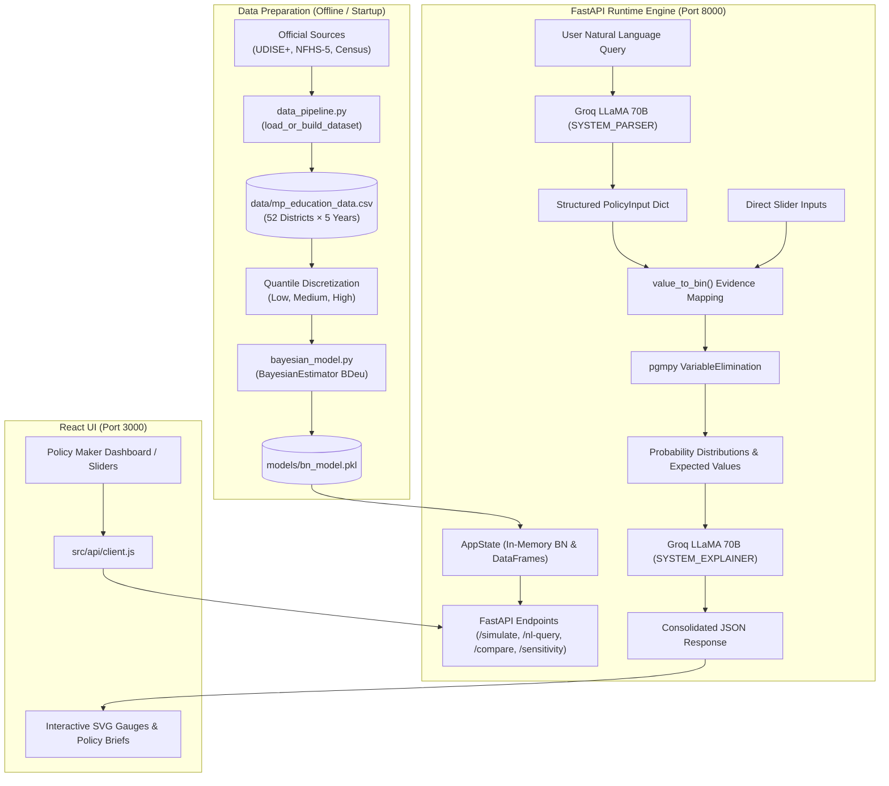
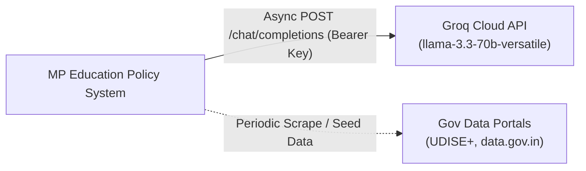
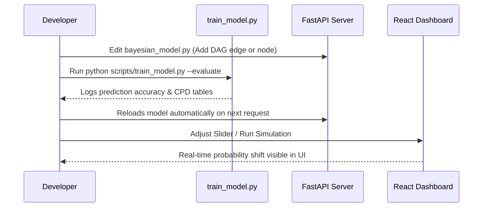

# ◈ Repository Understanding: MP Education Policy Modeling System

> **Target Audience:** Developers, researchers, and technical contributors joining the project.  
> **Repository Purpose:** AI-powered Bayesian simulation and natural language policy advisory for education policy across Madhya Pradesh (MP), India.

---

## 1. What This Project Does (Simple Language)

Imagine a state education minister asks:  
*"If we invest ₹50 Crores to double digital access in rural schools and hire 15% more female teachers, what will happen to female literacy, dropout rates, and overall learning outcomes in tribal districts like Alirajpur or Dindori?"*

Historically, answering this required months of policy guesswork or static regression tables. This repository provides an **interactive "policy flight simulator"**:

1. **Causal Simulation:** Uses a **Bayesian Network** to model cause-and-effect relationships between education inputs (school budget, teacher-student ratio, infrastructure, mid-day meals, digital access) and long-term outcomes (enrollment, dropout rate, gender parity, literacy rate).
2. **Probabilistic What-If Scenarios:** Unlike simple regression lines that give a single fragile number, it outputs **probability distributions** (e.g., "72% probability of High literacy, 18% Medium, 10% Low").
3. **Natural Language Interface:** Policymakers can type free-form English queries (*"What if we reduce student-teacher ratio to 20:1 in rural schools?"*). An LLM (**LLaMA 3.3 70B via Groq**) translates the text into simulation inputs, runs the causal model, and explains the results in plain, government-ready policy prose with actionable recommendations.
4. **District-Level Granularity:** Holds official demographic, economic, and educational baselines for all **52 districts of Madhya Pradesh**, allowing district-specific interventions and historical trend analysis.

---

## 2. Tech Stack Used

| Layer | Technology | Version | Purpose |
|---|---|---|---|
| **Backend Framework** | **FastAPI** | `0.111.0` | High-performance asynchronous REST API framework |
| **ASGI Server** | **Uvicorn** | `0.30.1` | Asynchronous server running FastAPI |
| **Data Validation** | **Pydantic** | `2.7.1` | Request/response data validation and type enforcement |
| **Causal Modeling** | **pgmpy** | `0.1.25` | Directed Acyclic Graph (DAG) construction, Bayesian parameter fitting (BDeu prior), and Variable Elimination inference |
| **Data Science / Math** | **Pandas**, **NumPy**, **SciPy**, **Scikit-learn** | `2.2.2`, `1.26.4`, `1.13.1`, `1.5.0` | Quantile discretization, statistical transformations, metrics, and dataset synthesis |
| **LLM Provider** | **Groq Cloud API** | `llama-3.3-70b-versatile` | Ultra-fast LLaMA 70B inference for query parsing and narrative policy explanation |
| **HTTP Clients** | **HTTPX** & **Requests** | `0.27.0`, `2.32.3` | Async HTTP communication with Groq API and data download scripts |
| **Frontend Framework** | **React** | `18.3.1` | Reactive component-based user interface |
| **Frontend Bundler** | **Vite** | `5.3.4` | Fast development server and build tool |
| **Styling & UI** | **Modern CSS** | Native CSS3 | Custom dark-mode design system with CSS custom properties (~39 KB `index.css`) |
| **Data Visualizations** | **Native Reactive SVG** | Native React | Zero external chart libraries; custom SVG gauges, tornado charts, network graphs, and trend charts |
| **Presentation Engine** | **python-pptx** | `0.6.x`+ | Automated script generating the 14-slide executive presentation |

---

## 3. Folder Structure and Purpose of Each Major Folder

```
mp_edu_policy/
├── backend/                  # FastAPI web server and AI/causal modeling engine
│   ├── main.py               # API endpoints, FastAPI lifespan, CORS, and request routing
│   ├── bayesian_model.py     # DAG topology, CPD learning (pgmpy), Variable Elimination, sensitivity analysis
│   ├── data_pipeline.py      # Data loading, validation, quantile discretization, 52-district seed data
│   ├── llm_integration.py    # Groq API client, prompt engineering (parsing, explanation, comparison)
│   └── requirements.txt      # Python dependencies
│
├── frontend/                 # Single-page application built with React and Vite
│   ├── index.html            # HTML entry point with Inter font & viewport config
│   ├── package.json          # Node dependencies and build scripts
│   ├── vite.config.js        # Vite dev server configuration and reverse proxy
│   └── src/
│       ├── main.jsx          # React DOM mounting entry point
│       ├── App.jsx           # Root layout, navigation sidebar, global status context
│       ├── index.css         # Complete design system (tokens, layouts, dark theme)
│       ├── api/
│       │   └── client.js     # API fetch wrapper, input constraints, and metric configurations
│       └── components/
│           ├── Dashboard.jsx           # State overview KPIs and multi-metric trend charts
│           ├── PolicySimulator.jsx     # Policy input sliders and interactive outcome gauges
│           ├── PolicyComparison.jsx    # Side-by-side scenario comparisons (Scenario A vs B)
│           ├── SensitivityAnalysis.jsx # Tornado impact chart and strategic intervention rankings
│           ├── DistrictExplorer.jsx    # 52-district browser + NLQueryPanel + DAGViewer implementations
│           ├── DAGViewer.jsx           # Re-exports DAGViewer from DistrictExplorer
│           └── NLQueryPanel.jsx        # Re-exports NLQueryPanel from DistrictExplorer
│
├── data/                     # Data storage and source registries
│   ├── mp_education_data.csv # 5-year panel dataset (2017–2021) for 52 MP districts (260 rows)
│   └── data_sources.json     # Official citation metadata (UDISE+, NFHS-5, Census 2011, ASER)
│
├── models/                   # Serialized model weights and state definitions
│   └── bn_model.pkl          # Pickled Bayesian Network instance and state dictionaries
│
├── scripts/                  # Standalone administrative and execution scripts
│   ├── download_data.py      # Scrapes/fetches government data portals with synthetic fallback
│   ├── train_model.py        # Trains the Bayesian network, runs accuracy checks, saves pickle
│   └── create_ppt.py         # Automates generation of MP_Education_Policy_Presentation.pptx
│
├── .env.example              # Sample configuration file for environment variables
├── .gitignore                # Git ignore patterns (node_modules, venv, caches, env files)
├── README.md                 # Project README and quickstart guide
└── MP_Education_Policy_Presentation.pptx  # 14-slide executive presentation
```

---

## 4. Application Flow (How Data Moves Through the System)



### Step-by-Step Flow:
1. **Model Bootstrapping:** On FastAPI server launch, the lifespan hook checks for `models/bn_model.pkl`. If absent, it loads `data/mp_education_data.csv`, converts continuous variables into 3-tier discrete bins (`Low`, `Medium`, `High`), fits Dirichlet conditional probability distributions (CPDs), and serializes the model.
2. **Simulation Request:** When a user adjusts policy sliders (e.g. Per-Student Expenditure: ₹12,000, Teacher Ratio: 22), the frontend sends a `POST /simulate` payload.
3. **Quantile Evidence Mapping:** `value_to_bin()` compares the continuous input numbers against historical quantile cutoffs (33rd and 67th percentiles). Note: Metrics like `teacher_student_ratio` are inverted (fewer students per teacher = "High" quality).
4. **Bayesian Inference:** `VariableElimination` computes exact posterior marginal probabilities for target outcomes (`literacy_rate_bin`, `dropout_rate_bin`, `enrollment_rate_bin`, `gender_parity_index_bin`, `learning_outcome_bin`).
5. **Expected Value Calculation:** Posterior probabilities are mapped to numeric expected values using midpoint weights (e.g., Low=20, Medium=55, High=85) for intuitive visual gauges.
6. **AI Explanation:** If requested (`/explain` or `/nl-query`), the evidence and posterior distributions are formatted into a prompt for Groq LLaMA 70B, which produces contextual policy narrative and implementation recommendations.

---

## 5. Main Entry Points and Startup Process

### 1. Backend Server Entry Point: `backend/main.py`
- **Execution Command:** `uvicorn main:app --host 0.0.0.0 --port 8000 --reload` (run from `backend/`).
- **Startup Lifecycle (`lifespan` context manager):**
  1. Calls `load_or_build_dataset()` to load `data/mp_education_data.csv` (or generates it if missing).
  2. Runs `discretize_for_bn()` to generate discrete state matrices.
  3. Pre-calculates statewide summary metrics (`get_summary_stats()`).
  4. Loads `models/bn_model.pkl` into memory or trains a fresh model using `MPEducationBN.build_model()`.
  5. Attaches everything to the global `state` instance (`AppState`).

### 2. Frontend Web Application: `frontend/src/main.jsx`
- **Execution Command:** `npm run dev` (run from `frontend/`, opens on `http://localhost:3000`).
- **Startup Lifecycle:**
  1. Vite mounts `index.html` and executes `main.jsx`.
  2. `main.jsx` mounts `<App />` wrapped in React `StrictMode`.
  3. `App.jsx` issues a health-check call to `http://localhost:8000/health`.
  4. Global state (`systemStatus`, `lastSimResult`) is initialized and shared across tabs via `AppContext`.

### 3. Model Training CLI: `scripts/train_model.py`
- **Execution Command:** `python scripts/train_model.py [--rebuild] [--method bayes|mle] [--evaluate]`
- **Startup Lifecycle:** Standalone pipeline to re-generate dataset, fit Bayesian parameters, run accuracy evaluations on held-out data, and save the pickle file.

---

## 6. Key Files You Should Read First

If you are new to the codebase, read these files in the following order:

```
1. backend/bayesian_model.py  ──> Core causal assumptions, DAG edges, and probability math
2. backend/main.py            ──> All REST API contracts and server lifecycle
3. backend/data_pipeline.py   ──> Data schemas, 52-district ground truth, discretization rules
4. backend/llm_integration.py ──> Groq API client, prompt templates, and fallback behavior
5. frontend/src/api/client.js ──> Frontend API methods, default inputs, and slider configs
6. frontend/src/App.jsx       ──> Master navigation and tab switching structure
```

---

## 7. Database, API, and Authentication Overview

### Database Architecture
- **No Traditional Database:** The system does not use PostgreSQL, MongoDB, or SQLite.
- **Persistence Mechanism:**
  - Tabular data is stored as a flat file: `data/mp_education_data.csv` (52 districts × 5 years = 260 rows).
  - Model weights and network topology are stored as a binary Python pickle: `models/bn_model.pkl`.
  - Data and model are held entirely in server memory (`state` object in `backend/main.py`) for sub-millisecond inference speeds.

### API Overview (FastAPI)
All endpoints accept and return `application/json`:

| Method | Endpoint | Description |
|---|---|---|
| `GET` | `/health` | Returns server health, model status, and district count |
| `GET` | `/summary` | Returns statistical distributions (min, max, mean, std) |
| `GET` | `/trends` | MP-wide 5-year historical trends for key metrics |
| `GET` | `/dag` | Returns nodes and edges of the Bayesian Network for SVG visualization |
| `GET` | `/districts` | Returns latest year statistics for all 52 MP districts |
| `GET` | `/district/{name}` | Returns single district data, historical trends, and custom LLM analysis |
| `POST` | `/simulate` | Executes Bayesian inference for input policy parameters |
| `POST` | `/explain` | Takes simulation results and generates LLM policy explanation |
| `POST` | `/nl-query` | Parses English text into inputs, simulates, and explains end-to-end |
| `POST` | `/compare` | Compares two distinct policy scenarios side-by-side |
| `GET` | `/sensitivity` | Computes tornado sensitivity analysis for any chosen target metric |

### Authentication & Security
- **Endpoints:** Unauthenticated (designed for internal government/research dashboard deployment).
- **CORS:** Enabled with wildcard permissions (`allow_origins=["*"]`) for easy local development.
- **External Auth:** Groq API calls require a Bearer token supplied via `GROQ_API_KEY` in `.env`.

---

## 8. External Services and Integrations



1. **Groq Cloud API (`api.groq.com`):**
   - Model: `llama-3.3-70b-versatile`
   - Purpose: Natural language query parsing, scenario explanation, comparative policy narratives.
   - Fallback Graceful Degradation: If `GROQ_API_KEY` is missing or invalid, the backend does not crash; it returns fallback warnings while allowing the Bayesian simulations to function completely.
2. **Government Data Portals (Data Ingestion Script):**
   - UDISE+ Public Mirror API (`src.udiseplus.gov.in`)
   - Open Government Data Platform (`data.gov.in`)
   - Fallback Seed: When external government portals are firewalled or down, `data_pipeline.py` uses pre-compiled official district factsheets for MP.

---

## 9. How to Run the Project Locally

### Prerequisites
- Python 3.10 or higher
- Node.js 18 or higher (with `npm`)
- (Optional) Free Groq API Key from [console.groq.com](https://console.groq.com/)

### Step 1: Clone and Configure Environment
```bash
git clone <repo-url>
cd mp_edu_policy

# Create .env from template
cp .env.example .env
# Open .env in your editor and insert your GROQ_API_KEY (optional but recommended)
```

### Step 2: Backend Setup
```bash
cd backend
python -m venv venv

# Activate Virtual Environment:
# On Windows:
venv\Scripts\activate
# On Linux/macOS:
source venv/bin/activate

# Install Python requirements
pip install -r requirements.txt

# Return to root to initialize data and model
cd ..
python scripts/download_data.py
python scripts/train_model.py

# Launch FastAPI server
cd backend
uvicorn main:app --host 0.0.0.0 --port 8000 --reload
```
*Backend will be running at:* `http://localhost:8000` (Swagger docs at `http://localhost:8000/docs`)

### Step 3: Frontend Setup
Open a **second terminal window**:
```bash
cd mp_edu_policy/frontend
npm install
npm run dev
```
*Frontend will be running at:* `http://localhost:3000`

---

## 10. Common Development Workflow



### Typical Development Scenarios:
- **Modifying the Causal Graph:**  
  1. Open `backend/bayesian_model.py` and modify the `EDGES` list or `NODE_METADATA`.
  2. If new columns are needed, add their generation logic in `backend/data_pipeline.py`.
  3. Re-train and validate by running `python scripts/train_model.py --evaluate`.
- **Refining LLM Policy Prompts:**  
  1. Open `backend/llm_integration.py`.
  2. Modify `SYSTEM_PARSER`, `SYSTEM_EXPLAINER`, or `SYSTEM_COMPARE`.
  3. Test directly by running `python backend/llm_integration.py`.
- **Adding Frontend Metrics / Sliders:**  
  1. Declare the new variable parameters in `frontend/src/api/client.js` (`INPUT_CONFIGS` or `OUTPUT_CONFIGS`).
  2. Wire up the state in `PolicySimulator.jsx` or `PolicyComparison.jsx`.

---

## 11. Potential Improvements and Code Smells

During architectural analysis, the following areas for refactoring were identified:

1. **Vite Reverse Proxy Mismatch (Code Smell):**  
   `frontend/vite.config.js` defines a proxy for `/api` pointing to `http://localhost:8000`, but `frontend/src/api/client.js` directly calls `http://localhost:8000` without the `/api` prefix. The proxy is currently bypassed.  
   *Fix:* Standardize on relative URLs (`/api/...`) and update FastAPI routes or proxy rewrites accordingly.
2. **Component Coupling & Re-Export Anti-Pattern:**  
   `DistrictExplorer.jsx` is 483 lines long and contains the full implementations of `DistrictExplorer`, `NLQueryPanel`, and `DAGViewer`. Meanwhile, `DAGViewer.jsx` and `NLQueryPanel.jsx` are 1-line files that simply re-export from `DistrictExplorer.jsx`.  
   *Fix:* Separate each component into its own dedicated file to improve readability and tree-shaking.
3. **In-Memory Global State Concurrency:**  
   `state = AppState()` in `backend/main.py` stores mutable pointers to pandas DataFrames and the pgmpy model. Under high concurrency or multi-worker uvicorn deployments (`--workers 4`), state is not shared or synchronized across processes.
4. **LLM Output Parsing Fragility:**  
   In `backend/llm_integration.py`, `_safe_parse_json()` uses regex pattern matching to extract JSON from LLM markdown fences. While robust for standard outputs, using Groq's JSON mode (`response_format={"type": "json_object"}`) or Pydantic Structured Outputs would eliminate parsing failures.
5. **Pickle Vulnerability & Portability:**  
   `models/bn_model.pkl` relies on standard Python `pickle`. Pickled models cannot be reliably loaded across different Python minor versions or pgmpy breaking releases.  
   *Fix:* Persist DAG structure as JSON/BIF and CPD tables as NumPy arrays or parquet.
6. **Hardcoded API Key in Scripts:**  
   `scripts/download_data.py` contains a sample open data key hardcoded in the query string (line 85). This should be moved to `.env` (`DATA_GOV_IN_API_KEY`).
7. **Test Coverage:**  
   The repository currently lacks automated unit or integration tests (no `tests/` directory). Adding a `pytest` suite for API endpoint contracts and BN inference edge cases is recommended.

---

## 12. Beginner-Friendly Summary of the Architecture

Think of this project as a **two-brain flight simulator** for education policy:

```
┌──────────────────────────────────────────────────────────┐
│                     USER INTERFACE                       │
│    (React Dashboard: Sliders, Gauges, District Explorer) │
└───────────────▲──────────────────────────▲───────────────┘
                │                          │
        1. Numerical Values         2. Plain English
        (Sliders: ₹, Ratio, %)      ("What if we do X?")
                │                          │
                ▼                          ▼
┌──────────────────────────────┐ ┌─────────────────────────┐
│       THE MATH BRAIN         │ │    THE LANGUAGE BRAIN   │
│   (Bayesian Network / pgmpy) │ │    (Groq LLaMA 70B)     │
│                              │ │                         │
│ Calculates probabilities     │ │ Translates questions    │
│ based on causal graph logic. │ │ into numbers, and turns │
│ No hallucinations.           │ │ output numbers into     │
│ Pure statistical rigor.      │ │ policy action advice.   │
└───────────────▲──────────────┘ └─────────▲───────────────┘
                │                          │
                └───────────┬──────────────┘
                            │
              FastAPI Orchestrator (main.py)
```

- **The Math Brain (Bayesian Network):** Knows the factual, statistical connections between school funding, teacher ratios, dropout rates, and literacy. It doesn't guess or hallucinate—it calculates exact mathematical probabilities.
- **The Language Brain (Groq LLaMA 70B):** Acts as the translator and executive advisor. It converts everyday human questions into numbers for the Math Brain, and takes the Math Brain's dry probability charts and explains them like a senior policy consultant.
- **The Dashboard (React):** Gives human policymakers intuitive knobs, dials, and interactive maps so they can test interventions in seconds before spending millions of Rupees in the real world.
