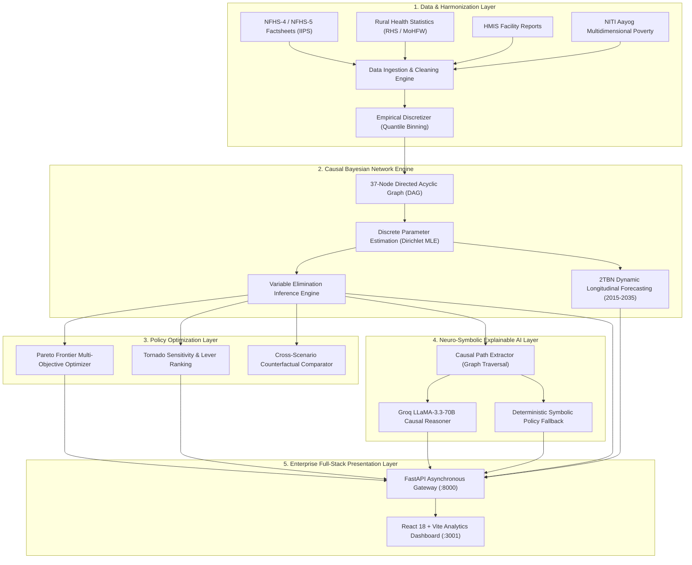

# National Healthcare Policy Prediction and Decision Intelligence System (NHP-DIS)
## Document 01: Complete System Design Document (SDD)

---

### Executive Summary

The **National Healthcare Policy Prediction and Decision Intelligence System (NHP-DIS)** is a production-grade, research-caliber decision support platform designed to assist the Ministry of Health and Family Welfare (MoHFW), NITI Aayog, state health directorates, and international health agencies (WHO, UNICEF) in evaluating, simulating, and optimizing public health interventions across India's 698 official administrative districts.

Unlike black-box neural networks or correlational regression packages, NHP-DIS is architectured upon **Pearl's Structural Causal Models (SCMs)** and **Bayesian Networks (BNs)**. This architecture supports:
1. Exact probabilistic inference under uncertainty.
2. Interventional query computation ($do$-calculus) rather than observational conditioning ($P(Y|X) \neq P(Y|do(X))$).
3. Longitudinal trajectory forecasting (2015–2035) via a 2-Time-Slice Dynamic Bayesian Network (2TBN).
4. Neuro-symbolic explainability powered by Large Language Models (LLaMA-3.3-70B) grounded in formal causal graph pathways.

---

### 1. High-Level Architecture Overview

The system comprises five decoupled architectural layers:

---

### 2. Detailed Subsystem Specifications

#### 2.1 Ingestion & Harmonization Pipeline (`backend/data_pipeline.py`)
- **Raw Input Ingestion:** Extracts official district-level indicators from:
  - International Institute for Population Sciences (IIPS) National Family Health Survey (NFHS-4 2015-16, NFHS-5 2019-21).
  - MoHFW Rural Health Statistics (RHS 2021) hospital bed and clinical staff availability.
  - NITI Aayog Multidimensional Poverty Index (MPI) Headcount Ratios.
- **District Harmonization:** Standardizes district identifiers across historical boundary realignments (e.g., bifurcated districts in Andhra Pradesh, Ladakh, Chhattisgarh).
- **Quantile Discretization:** Transforms continuous measurements into 3-tier discrete ordinal distributions (`Low`, `Medium`, `High`) based on national empirical tertiles ($T_{33\%}, T_{66\%}$), preserving non-linear tail behaviors while preventing zero-frequency conditioning traps.

#### 2.2 Causal Probabilistic Engine (`backend/bayesian_network.py`)
- **Structure:** 37 distinct random variables spanning 7 domains: Spending, Infrastructure, Human Resources, Preventive Care, Social Determinants, Intermediate Health Capacities, and Primary Morbidity/Mortality Outcomes.
- **Topology:** 52 directed causal edges validated against WHO epidemiological literature and MoHFW clinical guidelines.
- **Inference:** Exact probabilistic inference via Variable Elimination (`pgmpy.inference.VariableElimination`).
- **Intervention Logic ($do$-operator):** Policy simulations replace conditional factor distributions $P(X_i | \text{Pa}(X_i))$ with degenerate indicator distributions $I(X_i = x^*)$, cutting incoming parent edges to isolate direct and indirect causal impacts.

#### 2.3 Longitudinal Dynamic Bayesian Network (`backend/dynamic_bayesian_network.py`)
- **Temporal Framework:** 2-Time-Slice Dynamic Bayesian Network (2TBN).
- **State Transition Matrix:** $P(X_{t} | X_{t-1}, \mathbf{U}_t)$ estimated via empirical secular drift and auto-regressive Markov persistence calculated across NFHS wave intervals.
- **Simulation Horizons:** 2015 through 2035, outputting yearly expected values for Infant Mortality Rate (IMR), Maternal Mortality Ratio (MMR), and Life Expectancy under status-quo drift versus target intervention packages.

#### 2.4 Neuro-Symbolic XAI Engine (`backend/xai_engine.py`)
- **Path Extraction:** Traverses the active DAG from conditioned policy levers to downstream health indices, identifying active chains (e.g., $\text{specialist\_availability} \rightarrow \text{service\_quality} \rightarrow \text{maternal\_health\_status} \rightarrow \text{maternal\_mortality\_rate}$).
- **LLM Grounding:** Generates concise, hallucination-free executive briefs by binding prompts strictly to quantitative posterior probabilities and extracted graph paths.
- **Fallback Guarantee:** An offline deterministic heuristic synthesizer ensures 100% operational uptime without requiring third-party API availability.

---

### 3. Data Flow & Latency Specifications

| Step | Operation | Algorithmic Mechanism | Target SLA |
| :--- | :--- | :--- | :--- |
| 1 | Ingestion & Discretization | Vectorized Pandas Binning | $< 250\text{ ms}$ on boot |
| 2 | Model Training / Load | Discrete Maximum Likelihood Estimation | $< 800\text{ ms}$ on boot |
| 3 | Policy Simulation (`/simulate`) | Exact Variable Elimination (VE) | $< 180\text{ ms}$ per request |
| 4 | Longitudinal 20-Year Forecast (`/forecast`) | 2TBN Forward Unrolling | $< 95\text{ ms}$ per request |
| 5 | Tornado Sensitivity Analysis (`/sensitivity`) | Factor Marginalization across 12 levers | $< 350\text{ ms}$ per request |
| 6 | Multi-Objective Optimization (`/optimize`) | Non-dominated Pareto frontier sort | $< 220\text{ ms}$ per request |
| 7 | Natural Language Copilot (`/nl-query`) | Neuro-Symbolic Causal Synthesis | $< 1.8\text{ s}$ per query |

---

### 4. Hardware & Deployment Parameters
- **Operating Environment:** Linux (Ubuntu 22.04 LTS / Alpine) / Windows Server / macOS.
- **Minimum Requirements:** 2 vCPUs, 4 GB RAM, 2 GB SSD.
- **Recommended Production Cluster:** 4 vCPUs, 8 GB RAM, Kubernetes replica set (horizontal pod autoscaling triggered at 70% CPU).
