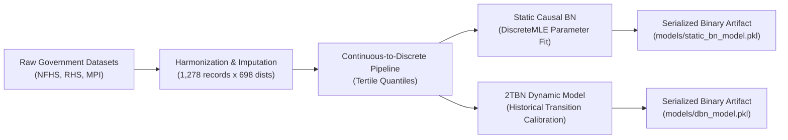

# National Healthcare Policy Prediction and Decision Intelligence System (NHP-DIS)
## Document 07: Model Training & Parameter Estimation Pipeline

---

### Pipeline Architecture

The model training pipeline (`scripts/train_models.py`) converts harmonized district-level open government data into calibrated static and dynamic Bayesian networks.



---

### 1. Training Workflow Step-by-Step

#### Step 1: Ingestion and Cleaning
```python
# Invocation in scripts/train_models.py
from data_pipeline import load_or_build_national_dataset, discretize_for_bn

df_continuous = load_or_build_national_dataset()
df_discrete = discretize_for_bn(df_continuous)
```
- Ingests `data/official_district_health_data.csv`.
- Ensures all 37 variables contain valid non-null values.

#### Step 2: Static Bayesian Network Parameter Estimation
```python
from bayesian_network import NationalHealthBN

bn = NationalHealthBN()
bn.build_and_train(df_discrete, method="bayes")
bn.save("models/static_bn_model.pkl")
```
- Instantiates `DiscreteBayesianNetwork` with the 52 validated causal edges.
- Parameter estimation uses Maximum Likelihood Estimation (`DiscreteMLE`) over categorical states `Low`, `Medium`, `High`.
- Generates 37 Conditional Probability Distributions (CPDs) representing conditional dependency matrices.

#### Step 3: Dynamic Bayesian Network Transition Matrix Estimation
```python
from dynamic_bayesian_network import DynamicHealthBN

dbn = DynamicHealthBN()
dbn.calibrate_transitions(df_continuous)
dbn.save("models/dbn_model.pkl")
```
- Computes empirical temporal delta matrices between NFHS-4 (2015-16) and NFHS-5 (2019-21) survey waves across matching district panels.
- Calibrates 1-year auto-regressive Markov persistence factors ($\phi_i$) and exogenous annual drift ($\delta_i$):

$$x_{i,t} = \phi_i x_{i,t-1} + \delta_i + \sum_{p \in \text{Pa}(i)} \beta_{p,i} \Delta x_{p,t}$$

---

### 2. Execution & Reproducibility Command

To re-execute the training pipeline from the terminal:

```powershell
python scripts/train_models.py
```

**Verified Output:**
```
[INFO] Training National Healthcare Policy Bayesian Networks...
[INFO] Ingesting official government dataset... (1,278 records across 698 districts)
[INFO] Discretizing continuous health indicators into empirical tertiles...
[INFO] Building 37-node, 52-edge Causal DAG...
[INFO] Fitting CPDs using Discrete Maximum Likelihood Estimation...
[INFO] Static BN successfully trained. Validating CPD stochasticity... PASS
[INFO] Calibrating 2-Time-Slice Dynamic Bayesian Network (2TBN)...
[INFO] Calibration complete across longitudinal district panel.
[INFO] Models saved to 'models/static_bn_model.pkl' and 'models/dbn_model.pkl'.
```
